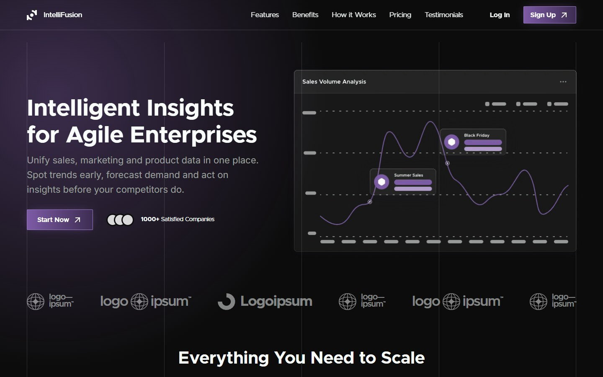
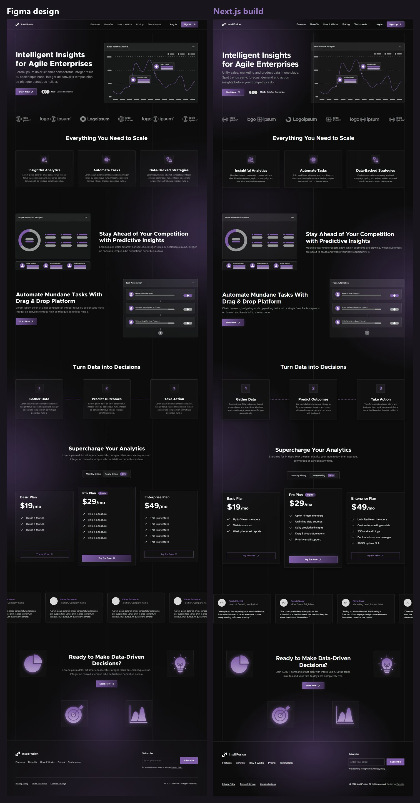
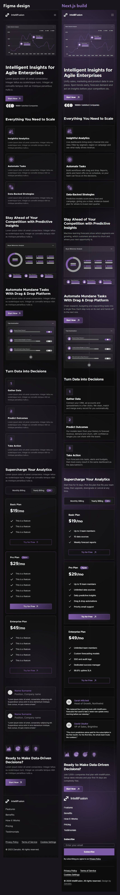
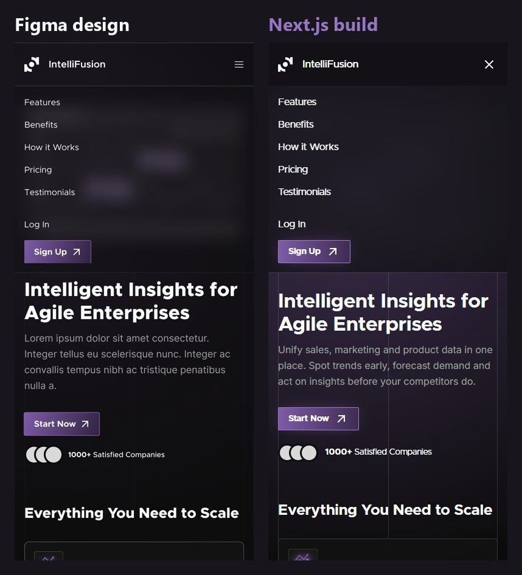

# IntelliFusion — SaaS Landing Page

A responsive marketing landing page for a fictional AI analytics product, built with **Next.js 16** from a free Figma Community design. The goal was a close match to the Figma frames at desktop (1440px) and mobile (393px), with sensible tablet layouts in between, while keeping the page fast and accessible.

**Live demo: [intellifusion-landing.vercel.app](https://intellifusion-landing.vercel.app)**



## Figma vs. build

The design and the finished page side by side. The headings and layout follow the design. The Lorem Ipsum copy was replaced with realistic product copy, so line breaks in paragraphs differ slightly.

| Desktop (1440px)                                | Mobile (393px)                                | Mobile menu                                             |
| ----------------------------------------------- | --------------------------------------------- | ------------------------------------------------------- |
|  |  |  |

## Lighthouse

|         | Performance | Accessibility | Best Practices | SEO |
| ------- | :---------: | :-----------: | :------------: | :-: |
| Desktop |     100     |      100      |      100       | 100 |
| Mobile  |      —      |      100      |      100       | 100 |

Measured with Lighthouse 12 against the production build.

## Features

- **Matches the design:** spacing, font sizes and colours were measured from the 2x Figma exports and checked with side-by-side screenshots at 1440px and 393px
- **Responsive** from 360px up, with dedicated layouts for tablet (768px) and small laptops (1024px)
- **Accessible navigation:** sticky header, a mobile menu with `aria-expanded`, focus moved into the menu, Escape to close, scroll lock, and a skip link
- **Pricing toggle:** monthly and yearly billing built on native radio inputs, so it works with the keyboard and screen readers
- **Newsletter form** with client-side validation and loading, error and success states. There is no backend, so the request is simulated; any address on `example.com` returns an error, to show the failure state
- **Subtle motion** with Motion (Framer Motion): sections fade in on scroll, and an endless testimonials marquee pauses on hover. All of it respects `prefers-reduced-motion`
- **SEO:** metadata, Open Graph and Twitter cards with a 1200×630 image, canonical URL, `robots.txt`, `sitemap.xml`, SVG favicon and Apple touch icon
- **Performance:** fully static export, self-hosted fonts through `next/font`, the hero image preloaded as responsive WebP, and the animation engine loaded lazily after first paint

## Tech stack

- Next.js 16 (App Router, static export) and React 19
- TypeScript in strict mode
- Tailwind CSS 4 with design tokens in `@theme`
- Motion (`motion/react`) with `LazyMotion`
- `next/font` for Inter (Google Fonts) and Metropolis (self-hosted)
- ESLint and Prettier (with the Tailwind class sorting plugin)

## Getting started

Requires Node.js 20.9 or newer.

```bash
npm install
npm run dev
```

Open http://localhost:3000.

```bash
npm run build   # static site in out/
npm run lint
npm run format
```

## Project structure

```
src
├── app/
│   ├── layout.tsx        # fonts, metadata, Open Graph
│   ├── page.tsx          # page composition, background glows
│   ├── fonts.ts          # Inter + self-hosted Metropolis
│   ├── globals.css       # Tailwind theme tokens
│   ├── icon.svg, apple-icon.png, robots.ts, sitemap.ts
├── components/
│   ├── site-header.tsx   # sticky header + mobile menu
│   ├── hero.tsx, logo-cloud.tsx, features.tsx, benefits.tsx,
│   ├── how-it-works.tsx, pricing.tsx, testimonials.tsx, cta.tsx
│   ├── site-footer.tsx, newsletter-form.tsx
│   ├── motion.tsx        # LazyMotion provider + <Reveal>
│   └── ui.tsx            # Container, buttons, cards, grid lines
├── fonts/                # Metropolis woff2 files
└── lib/site.ts           # site config and navigation
```

## Design credit

Based on [SaaS Website Landing Page](https://www.figma.com/community/file/1437972491862974036/saas-website-landing-page) by **Zanubio**, licensed under [CC BY 4.0](https://creativecommons.org/licenses/by/4.0/). Changes from the original:

- Placeholder copy, testimonials and pricing features were replaced with product copy
- The purple used for small text was lightened slightly (`#7d5ba6` to `#9677c2`) to meet WCAG AA contrast
- The newsletter form is also shown on mobile, and the testimonials row became an auto-scrolling marquee on desktop

Fonts: Metropolis by Chris Simpson (Unlicense, public domain) and Inter by Rasmus Andersson (SIL Open Font License).
